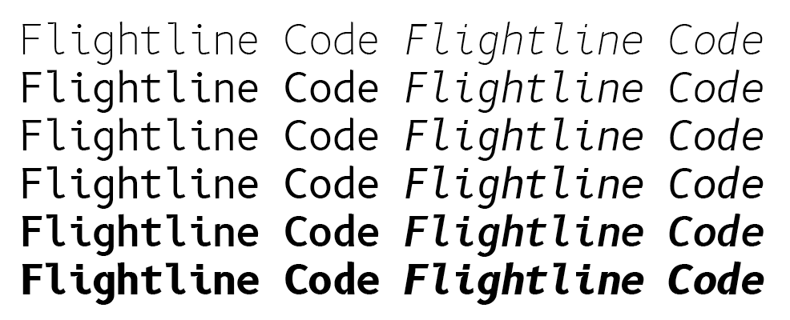
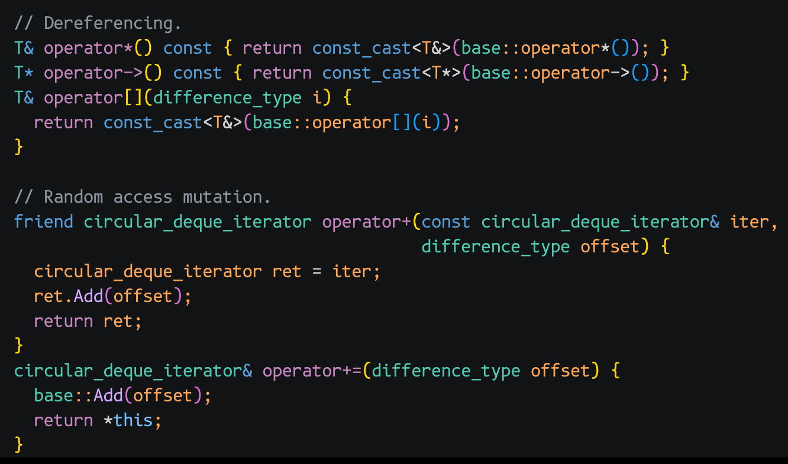
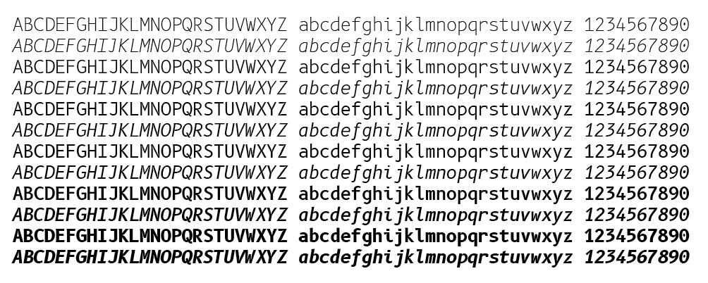

# Flightline Code Font

Flightline Code is a clean, readable font designed for coding, terminal, and other general screen
use. While being extremely legible, it maintains a hint of old-fashined quirkiness combined with
modern humanist design.

14pt Flightline Code on Mac in Visual Studio Code:

It is based on the excellent [B612 Mono](https://github.com/polarsys/b612) font from Airbus with
significant modifications to make it more appropriate for computer and programming use. Please see
the [comparison with B612 Mono](docs/B612-Mono-comparison.md) for details.

## Weights

## Copyright

Copyright (c) 2012, AIRBUS (airbus-group.com). All rights reserved.

Copyright (c) 2026 Brett Wilson

## License

This program and the accompanying materials are made available under the terms of the Eclipse Public
License v2.0 and Eclipse Distribution License v1.0 and the SIL Open Font License v1.1 which
accompanies this distribution. The Eclipse Public License is available at
[https://www.eclipse.org/legal/epl-v20.html](https://www.eclipse.org/legal/epl-v20.html) and the
Eclipse Distribution License is available at
[https://www.eclipse.org/org/documents/edl-v10.php](https://www.eclipse.org/org/documents/edl-v10.php).
The SIL Open Font License v1.1 is available at
https://scripts.sil.org/OFL](https://scripts.sil.org/OFL)
