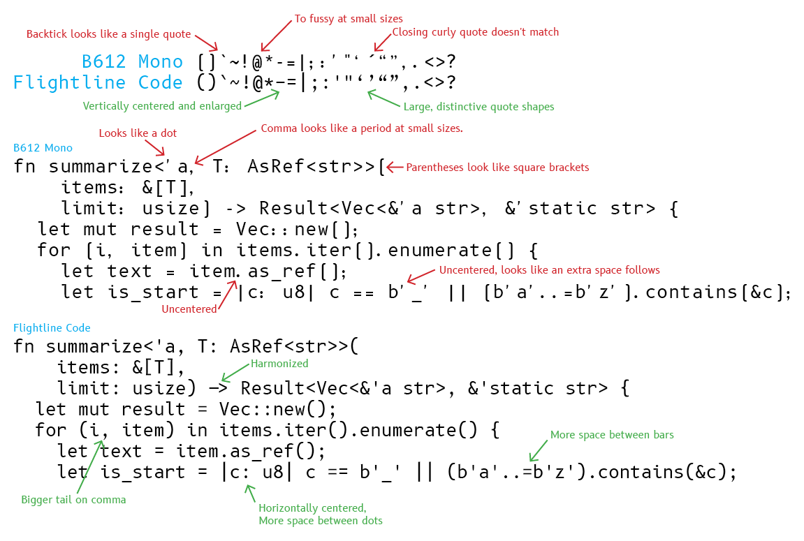
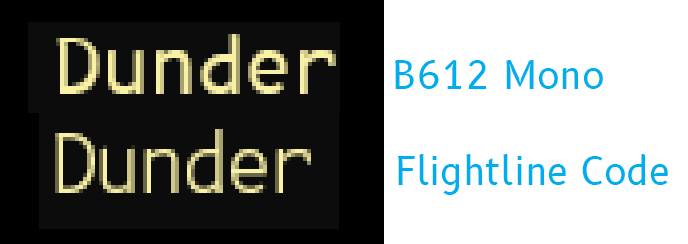

# Comparison to B612 Mono

## Weight differences

B612 Mono has only Regular and Bold weights. Flightline Code adds Thin, Extra Light, Light, and
Medium variants. The lighter versions in particular are more appropriate for terminal use.

## Stylistic differences

Flightline Code has less space between the characters, with a width of 1.2× the height, while B612
is 1.3× the height. For some wider characters like “m”, the glyph has been modified slightly to
allow for sufficient spacing.

The punctuation has been significantly modified to be appropiate for computer programming and
other technical uses. B612 Mono uses irregular glyph positioning in the character cell. This may be
appropriate for some textual uses, but looks very strange for most computer programming languages.

Some commonly confusable glyphs have been modified to make them more distinct:

 * Zero has a dot to differentiate it from a capital letter “O”.
 * Parentheses have been redrawn completely to make them more curvy, as B612 Mono’s parenthesis look
   very much like square brackets.
 * Comma and curly quotes have been enlarged to look more distinct from a period and straight
   quotes.
 * Backtick has been expanded to differentiate it from a single quote.

The “@” sign has been redrawn to be simpler, which makes it more clear at typical small screen
sizes.

The default parenthesis, brackets, and braces are vertically aligned with capital letters and
numbers (“lining” figures) rather than vertically centering on lower-case letters like B612 Mono. I
believe this looks better in most computer programming contexts. The lowered versions are kept as
variants if you prefer. Contextual rules automatically select these variants in some cases.

Some letters have simplifications like inktraps removed or stroke thickness made more uniform so the
letters appears more regular at typical screen sizes.

## Technical differences

Hinting has been significantly improved for good rendering on Windows. While Mac generally ignores
hints and renders with softer antialiasing for greater design fidelity, Windows aggressively fits to
the pixel grid. My impression is that the hinting of B612 Mono was a combination of autohinting and
leftovers from the proportionally spaced variant. In some cases, the alignment zones for the
proportionally spaced version are still present in the monospaced file! Flightline Code removes a
lot of unnecessary and occasionally harmful hinting, and adds hints that improve the regularity
significantly.

The worst case for B612 rendering is in the terminal at 14pt with 100% display zoom, illustrated
here. Some strokes are inconsistent width, especially the top of the “D” and “P”, and the top of
some of the lower-case letters, like the top of the bowl of the “d” are not vertically aligned.

See [trademarks](../trademarks.md)
